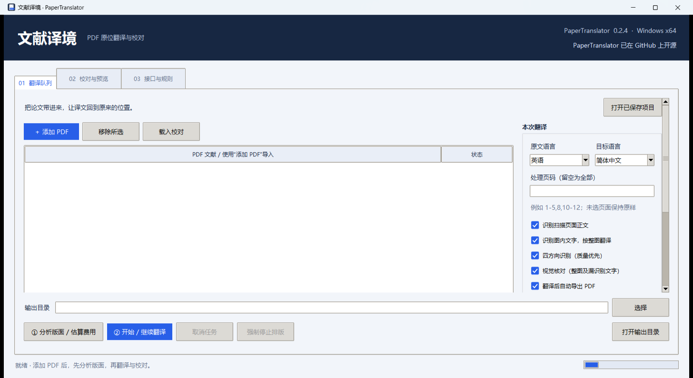
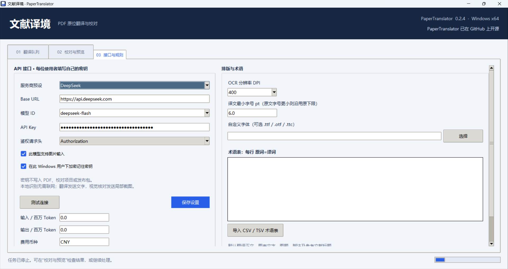
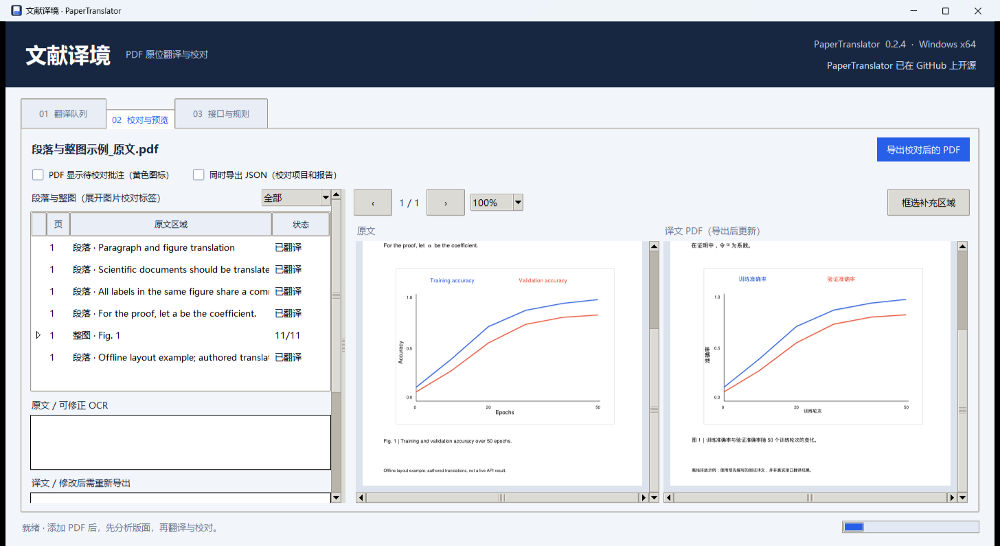
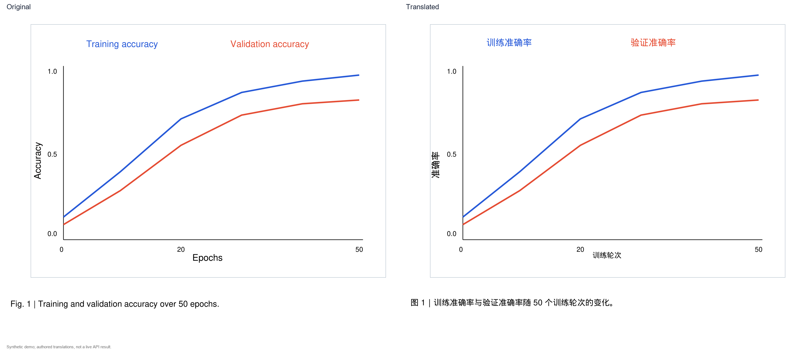
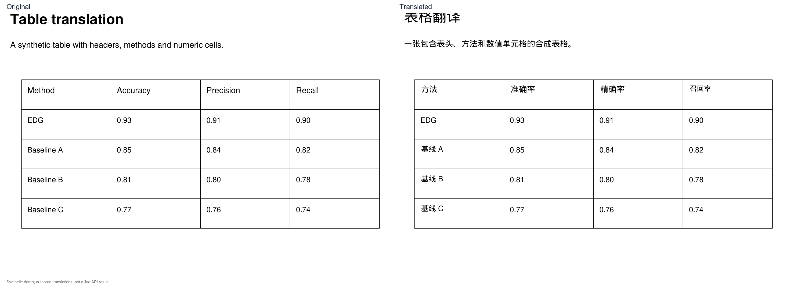

# 文献译境 · PaperTranslator

**English** | [简体中文](README.zh-CN.md)

[](LICENSE)
[](pyproject.toml)
[](#requirements)

PaperTranslator is a Windows desktop application for **position-preserving PDF translation and human review**. It is designed for computer-science and mathematics papers: paragraphs are translated as complete units, figure labels and captions are translated together, and formulas, numbers, URLs and citation markers are protected. The translated text is written back into the original page areas instead of producing a separate plain-text document.

The default direction is English → Simplified Chinese. DeepSeek and Xiaomi MiMo presets are included, and any Chat Completions-compatible endpoint can be configured.

> The source code lives in this repository. Prebuilt Windows builds are published on the [Releases](https://github.com/foogtil/PaperTranslator/releases) page and are uploaded separately from the source tree. You can also build from source with the instructions below.

## Download

Prebuilt Windows builds are published on the [Releases](https://github.com/foogtil/PaperTranslator/releases) page. Each release should include:

- the portable ZIP (with licenses and third-party sources),
- the standalone `.exe`,
- the source ZIP,
- the verified `vendor-sources` archives required as AGPL corresponding source,
- SHA-256 checksums.

## Screenshots

The document screenshots use a synthetic demo PDF and authored test translations. They do not contain third-party paper content.

| Main window | API and layout settings |
|---|---|
|  |  |

### Paragraph and figure review



### Figure and table translation





## Features

- **Position-preserving output** — page count, page size, CropBox, rotation and unselected pages are preserved. Translated text is searchable and selectable.
- **Paragraph-level translation** — lines are rebuilt into complete paragraphs using layout, indentation and font cues, so a paragraph is not translated word by word.
- **Whole-figure translation** — embedded images, vector figures and multi-panel figures are grouped so all labels and the caption share one context.
- **Formula protection** — inline formulas are carried over as vector fragments from the source PDF; `[[MATH_n]]` placeholders are protected during translation.
- **Local OCR** — RapidOCR + ONNX Runtime run on the CPU for scanned pages and text inside figures. Chinese and English models are bundled; no GPU is required.
- **Optional vision review** — when the selected model supports images, page screenshots can be sent to catch missed or rotated text. Text-only endpoints fall back to OCR context.
- **Placeholder protection** — numbers, formulas, URLs, DOIs and citation markers are replaced with placeholders before the request and restored only if the model preserves them.
- **Review workflow** — edit translations, correct labels, select extra OCR regions, save progress and re-export without re-requesting the API.
- **Optional review annotations and JSON** — yellow “needs review” annotations and `.ptrans.json` / `.report.json` export are off by default.
- **Provider flexibility** — DeepSeek, Xiaomi MiMo and custom Chat Completions endpoints; model ID, base URL and auth header are editable.
- **No bundled secrets or telemetry** — API keys live in the session by default; optional “remember” uses Windows DPAPI for the current user.

## Requirements

- Windows 10 / 11 x64.
- Python 3.11 or newer (tested with Python 3.13 x64).
- 8 GB RAM or more recommended.
- CPU-only OCR; no NVIDIA GPU required.
- Network access to the selected API. Depending on your network, a proxy or VPN may be required.

## Quick start (from source)

```powershell
python -m venv .venv
.\.venv\Scripts\python.exe -m pip install -r requirements.txt
.\.venv\Scripts\python.exe run.py
```

Alternatively, install the package and use the console entry point:

```powershell
python -m pip install -e .
paper-translator
```

`requirements.txt` pins the tested versions and also installs PyInstaller for building. If you only want to run from source, `pip install -e .` installs the runtime dependencies.

## Usage

1. Open **03 接口与规则** and choose DeepSeek, Xiaomi MiMo or a custom endpoint. Enter your own API key and click **测试连接**. Enable “此模型支持图片输入” only if the model accepts images.
2. Add PDFs with **添加 PDF** or drag and drop. Choose the source/target language, page range and output directory.
3. Click **分析版面 / 估算费用** and check the detected regions.
4. Click **开始 / 继续翻译**. Progress is saved; a cancelled task can be resumed. Long layout steps show per-step progress and a “no new progress” hint after 60 seconds.
5. Open **02 校对与预览** to compare the original and translated regions. Edit text, correct labels, or select an extra OCR region, then export the reviewed PDF.

The output is `name.id.译文.pdf`. The original PDF is never overwritten. Optional JSON files are written next to the PDF only when the corresponding option is enabled.

## Measured example

One real run on a 14-page English paper with figures and tables:

| Item | Value |
|---|---|
| Quality settings | All quality-first options enabled: four-way OCR, whole-figure translation, visual review |
| Model | DeepSeek `deepseek-flash` |
| Network | Proxied (VPN) environment |
| Time | About 34 minutes |
| Cost | **¥1.04 actual billed cost** (DeepSeek off-peak pricing) |

This is a single run, not a benchmark. Time and cost vary with page count, figure density, retries, network conditions and provider pricing. The run still produced review items: the application is designed for human review, not unattended, error-free batch translation.

## How it works

1. **Extraction** — PyMuPDF reads text spans, images, vector drawings and page geometry. Spans are grouped into paragraphs and figures; formulas and non-translatable items are classified.
2. **Protection** — numbers, formulas, URLs, DOIs and citation markers become placeholders. Author names and symbols can also be protected by rules.
3. **Translation** — paragraphs and whole-figure contexts are sent to a streaming Chat Completions endpoint. Empty or malformed results are retried per region; failed regions keep the original text and are marked for review.
4. **Layout** — the translation is written back into the original areas with an embedded font. Text is re-wrapped and shrunk within a minimum font size; regions that do not fit are not silently truncated.
5. **Review** — unresolved regions, low-confidence OCR, overflow, overlaps and image-repair uncertainty are recorded in the project and shown in the review UI.

## Limitations

- Automatic paragraph, figure and formula classification is heuristic. Real papers still need inspection, especially multi-column layouts, cross-page paragraphs, dense subfigures and unusual typography.
- Small text, curved labels, vertical text, text touching plot lines, and blurry scans may be missed or replaced imperfectly.
- A region that does not fit, overlaps a formula, or has low OCR confidence keeps the original text and is flagged. Hidden yellow annotations do not mean the issue is resolved.
- Output does not promise the original font, line count or exact glyph positions.
- The application targets Windows. It is not code-signed, and it has not been validated on every Windows device, DPI setting or GPU/driver combination.
- Translation quality, price and availability depend on the external provider you configure.

## Privacy and data

- No telemetry and no automatic upload server. Parsing and local OCR run on your machine.
- When you start translation, text is sent to the provider you configured. If vision review or whole-figure translation is enabled, page screenshots or cropped images are also sent.
- API keys are session-only by default. “Remember” stores the key encrypted with Windows DPAPI for the current Windows user in `%APPDATA%\PaperTranslator\settings.json`.
- Projects, reports and internal caches are stored locally and may contain the source text and translations. Treat them as sensitive when sharing.
- Do not process documents that you are not allowed to send to a third-party API.

## Build a Windows executable

```powershell
python scripts\fetch_sources.py   # download and verify third-party source archives
python scripts\build.py           # portable build, one-file build, source ZIP, licenses
```

The build refuses to package if `vendor-sources/` is missing or a checksum does not match. This is intentional: a distributed executable includes PyMuPDF/MuPDF and must ship the corresponding source and notices. See `TESTING.md` for the verification record and `DEFAULTS.md` for default decisions.

## License

PaperTranslator is licensed under the **GNU Affero General Public License v3.0 only** (`AGPL-3.0-only`).

- Copyright (C) 2026 foogtil.
- Full text: [LICENSE](LICENSE). Additional notice: [NOTICE](NOTICE).
- Third-party components and their licenses: [THIRD_PARTY_NOTICES.md](THIRD_PARTY_NOTICES.md) and `licenses/`.
- PyMuPDF / MuPDF are dual-licensed by Artifex under AGPL-3.0 or a commercial license. This project uses the AGPL-3.0 option. If you need a non-AGPL distribution, obtain a commercial PyMuPDF license or replace PyMuPDF.
- If you distribute a built executable, you must provide the corresponding source (including the exact PyMuPDF/MuPDF sources) and the third-party notices. The `vendor-sources/` archives attached to the release are the verified source set used by the build script.

This program is distributed in the hope that it will be useful, but **without any warranty**; without even the implied warranty of merchantability or fitness for a particular purpose. See the AGPL for details.

## Contributing

Issues and pull requests are welcome. By submitting a contribution, you agree that it may be distributed under `AGPL-3.0-only`.

Before opening a pull request:

```powershell
python -m unittest discover -s tests -v
```

## Acknowledgements

PyMuPDF / MuPDF (Artifex), RapidOCR and PaddleOCR, ONNX Runtime, OpenCV, NumPy, Pillow, HTTPX, TkinterDnD2 / tkdnd, and PyInstaller. See `THIRD_PARTY_NOTICES.md` for the full list and license locations.

DeepSeek and Xiaomi MiMo are external services. They do not sponsor or endorse this project.
