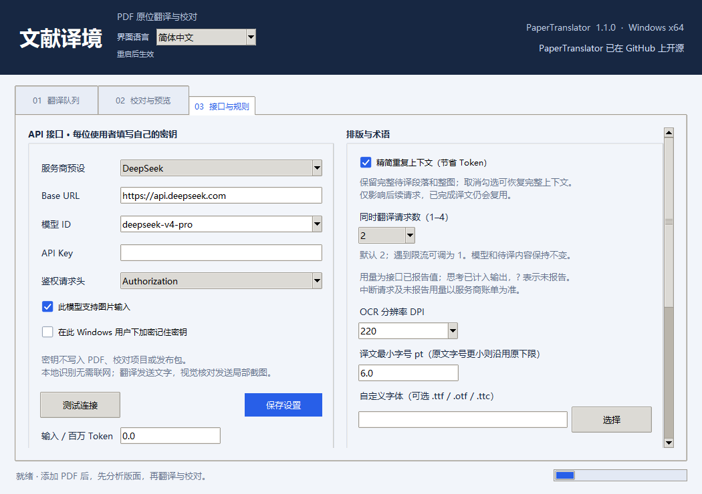

# 1.1.0 Token 与速度优化（2026-10-28）

## 翻译速度

「接口与规则」新增同时翻译请求数，默认 **2**，可选 **1–4**。相互独立的翻译批次并行等待接口返回，同一张图仍整体处理；每个请求的模型、提示词和待译内容与相同上下文选项下的单路模式一致。并发数量不会使成功译文缓存失效。遇到服务商限流时，可调回 1。

只有 HTTP 翻译请求并行：PDF 图片裁剪、OCR 和排版继续在原工作进程的主线程中执行，避免 PyMuPDF 多线程访问。并发请求的结果保存、用量汇总及进程消息发送均有同步保护；取消或失败后停止补发新请求，并保存已完成结果。

离线模拟 30 次请求、每次等待 0.04 秒：单路约 1.271 秒，双路约 0.643 秒，请求内容和待译 ID 一致。这不是实际服务商速度保证，真实耗时受限流、网络、模型推理、OCR 与排版影响。并发功能不削减上下文；下面的精简上下文功能可独立开关。

## 输入用量

在「接口与规则 → 排版与术语」中新增「精简重复上下文（节省 Token）」，默认开启。

- 待译段落和整图标签保持完整，保留术语表、公式占位符及原位置映射。
- 参考上下文优先保留附近段落与论文开头；论文开头参考最多 2400 字符、邻近参考最多 2000 字符，避免重复附带当前待译内容。
- 整图当前待译标签只发送一次，整图列表通过 ID 引用；重试时继续提供其他标签和已有译文供术语对照。图片输入设置保持原样。
- 取消勾选会恢复原有范围的参考上下文：论文开头最多 9000 字符、当前页最多 12000 字符。该选项仅影响下一次请求，切换不会清空成功译文。
- 排版溢出但已有译文的区域继续复用，修改字体或重新排版不会因此重新付费翻译。更换语言、术语表或模型仍按原规则使自动译文缓存失效。
- 响应含有额外未知 ID 时，忽略未知项并保留通过校验的已请求项；失败项继续按原有上限单独重试。

队列页新增当前文档累计用量：输入、输出、缓存输入、思考输出、请求数、重试数、用量缺失请求数，以及文字翻译和视觉核对的分类统计。

统计只采用 API 返回的 usage。缓存输入是输入的子集，思考输出是输出的子集，不能再次相加。没有报告的细项显示 `?`；中断、网络失败及未报告的用量不能当作免费，实际以服务商账单为准。旧项目缺少的新统计无法追溯补齐。测试连接不计入文档用量。

DeepSeek 官方接口请求流式 usage；MiMo 读取其文档声明的流式 usage 字段，保持原请求参数。自定义接口不额外强加未确认支持的参数。

- [DeepSeek Chat Completions](https://api-docs.deepseek.com/api/create-chat-completion/)
- [MiMo Chat Completions](https://mimo.mi.com/docs/en-US/api/chat/openai-api)

离线合成样例对比（14 页、216 个待译项，均为 30 次请求）：完整上下文模式输入 741038 字符，精简模式输入 309984 字符，减少 58.17%；两种模式的待译 ID 完全一致。运行 `python scripts/check_token_context.py` 可复现。此数值只表示该合成样例的请求文本量，不代表真实模型 token、账单或翻译质量改善幅度。

本次没有调用真实付费 API，未对真实论文进行模型翻译质量对照。对需要更长上下文才能消歧的论文，可关闭精简选项。模型、深度思考、OCR、视觉核对和输出长度设置保持原样。

原始 1.0.0 源码和发布包备份在 `build/token-backup-20261028-101957/`。0.2.4 和原始 1.0.0 及其发布包均保留。

